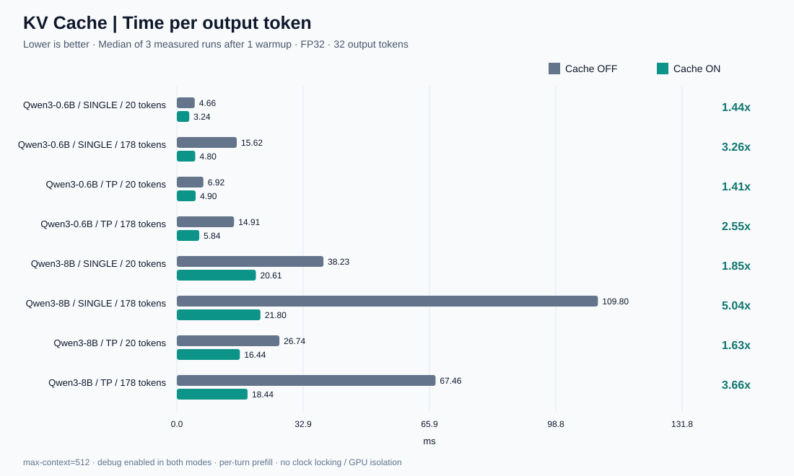
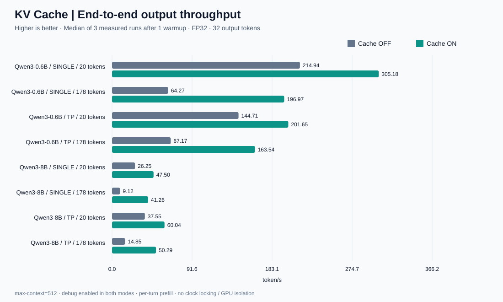
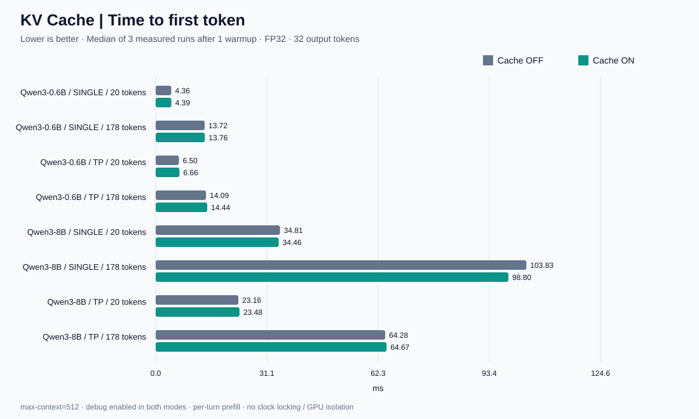

# 2026-11-18：可选 KV Cache

## 功能与实现

- 聊天新增 --kv-cache，默认关闭；支持单卡、两卡 PP/TP，旧计算路径保留。
- KVCache 管理每层 FP32 K/V 显存，K 在 head RMSNorm/RoPE 后缓存，V 在投影后缓存；Q 不缓存。
- 首次 prefill，后续对精确 token 前缀只处理新增后缀，支持多 token 追加；RoPE 使用绝对位置偏移，Attention 的 Q 长度可小于 KV 有效长度。
- TP 保存本卡 KV heads，PP 保存本阶段层。缓存容量与 max-context 关联，按层延迟分配，计算只使用有效长度。
- 前缀改变、重复/缩短输入、完整 logits 输出时重新计算。异常使前缀失效，下次重建。
- 每轮聊天 reset，不跨轮复用；clear 和滑动历史后的请求重新 prefill。reset 保留分配供复用，模型销毁时释放。
- debug 增加 kv_cache、kv_cache_bytes、prefill_ms、decode_ms；关闭缓存时 decode_ms 是后续全上下文重算时间。首次分配计入首次 prefill，缓存字节仅含已分配 K/V，不含权重或工作区。

## 当前边界

尚无独立 prefill/decode 服务、DP 调度或跨服务器 KV 交接；P/D 在同一模型实例。最终 RMSNorm 单行优化未混入本次改动。完整位置 forward(last_only=false) 不缓存。FP32 缓存总量为 2×层数×容量×KV heads×head_dim×4 字节；TP 为各卡本地 head 数求和。

## 验证与性能

验证：0.6B 单卡/PP/TP、8B PP/TP 的逐步logits与无缓存对照通过；测试包括非单token分块追加、修改前缀、重复/缩短输入、reset、完整输出失效及容量拒绝。0.6B TP 追加到512位置通过，最大绝对误差约4.01e-5。聊天多轮/clear开关对照通过；独立审查未发现阻塞问题。

性能归档：[开关对照](../benchmarks/kv-cache/20261118-104036/README.md)。输入20/178 token，输出32 token，预热1次测3次；8B长输入单卡TPOT约109.8→21.8ms，TP约67.5→18.4ms。全部开关组合生成文本一致。首token仍为prefill，收益主要在decode。

## 提交前检查

重新构建与4项CTest、聊天开关对照、0.6B TP缓存512位置/8B TP缓存64位置数值和原无缓存TP回归通过。独立审查检查RoPE offset、因果边界、前缀失效与异常恢复，未发现阻塞问题。性能原始数据、环境、源码哈希和快照一起保留；结果不代表锁频隔离环境下的普适加速比。

## 性能提升可视化

数据来自同一二进制的缓存开关对照：FP32、max-context=512、输出32 token，每组预热1次后测3次取中位数；短/长输入分别为20/178 token。各配置生成文本一致。横条旁为实测数值，TPOT 图右侧为无缓存/有缓存的加速比。

### 生成间隔 TPOT（越低越好）

### 端到端输出吞吐（越高越好）

吞吐包含首次 prefill，不能直接当作纯 decode 吞吐。

### 首 token 延迟 TTFT（越低越好）

缓存主要降低后续生成的重复计算；首 token 仍需 prefill，热态 TTFT 大体接近。未锁频或隔离其他负载，微小差异不作收益结论。原始数据和完整运行条件见前文性能归档。

复现图表：`python3 dev-notes/scripts/plot_kv_cache.py`。图表为无外部依赖的 SVG，可直接在 GitHub 开发记录中显示。
