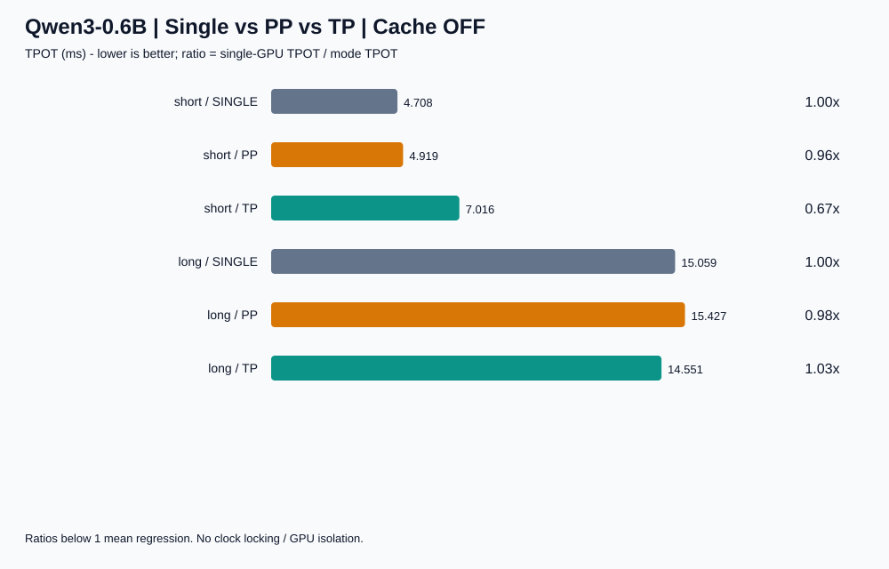
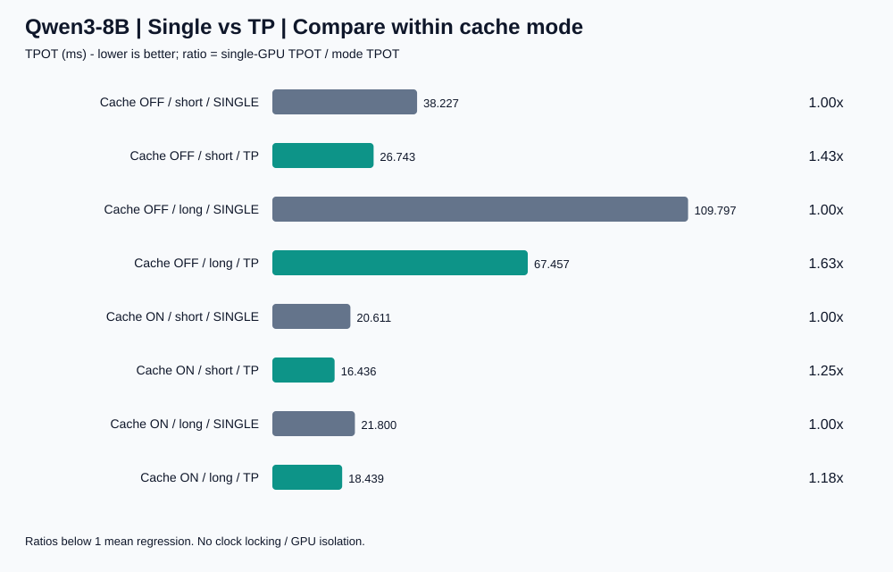

# 2026-11-18：补充 PP / TP 性能对比

本记录整理已归档数据，不新增性能测试。分别在同组内比较，不能跨日期/输入/缓存状态混算并行收益。速度比定义为单卡 TPOT / 当前模式 TPOT，大于1为加速，小于1为退化。

## 0.6B：单卡、PP、TP（无 KV Cache）

来源：[2026-11-17 原始基线](../benchmarks/baselines/2026-11-17-no-kv/README.md)。FP32，上下文256，每种配置独立加载；每个输入预热1次后测5次，取中位数，轮间清空历史。短输入23 token、输出32；长输入179 token、输出19。长短输入之间不直接比较吞吐，模式间仅比较相同输入/输出组。

|输入|模式|TTFT ms|TPOT ms|输出 token/s|相对单卡 TPOT 速度比|
|---|---|---:|---:|---:|---:|
|short|single|4.290|4.708|212.962|1.00x|
|long|single|13.630|15.059|63.315|1.00x|
|short|pp|4.368|4.919|204.018|0.96x|
|long|pp|14.508|15.427|61.582|0.98x|
|short|tp|6.526|7.016|142.779|0.67x|
|long|tp|13.862|14.551|65.409|1.03x|

结论：该单请求测试中PP没有加速；TP短输入退化，长输入TPOT仅约1.03x。长输入的小幅差异不足以证明稳定收益，需要更多重复和负载控制。当前PP为顺序分层执行，不是多请求微批流水线，因此不能据此判断生产并发PP的收益。

## 8B：同缓存状态下单卡与 TP

来源：[KV Cache 开关实验](../benchmarks/kv-cache/20261118-104036/README.md)。同一二进制、FP32、max-context=512，短/长输入20/178 token，均实际输出32 token；每组预热1次后测3次取中位数，debug开启。只在缓存状态相同的两行之间计算TP收益。

|缓存|输入|单卡 TPOT ms|TP TPOT ms|TP 加速比|
|---|---|---:|---:|---:|
|关闭|short|38.227|26.743|1.43x|
|关闭|long|109.797|67.457|1.63x|
|开启|short|20.611|16.436|1.25x|
|开启|long|21.800|18.439|1.18x|

结论：8B无缓存长输入TP约1.63x，开启缓存后长输入TP约1.18x。缓存降低重复计算后，两卡相对收益变小；具体瓶颈比例尚未profiling，不将这一现象当作纯通信耗时测量。

## 缺口与解释边界

- 8B PP 尚未收集同口径正式性能数据，不能补写为已验证收益。
- 图表不是新的跑分；历史数据未锁频或隔离其他GPU进程，样本量较小。
- TTFT、TPOT、整轮吞吐分别解释；当前数据不含高并发服务吞吐、同时双向链路或多请求PP调度。
- KV Cache开关收益见对应记录；本页TP收益固定缓存开关，二者不混用。

复现本页和图表：`python3 dev-notes/scripts/plot_parallel_performance.py`。
